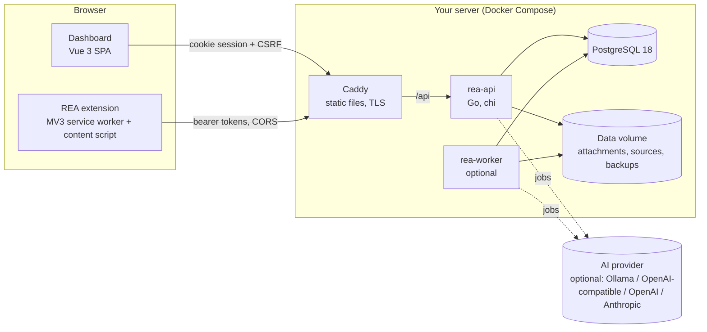

# Architecture

## Components

| Path | Role |
| --- | --- |
| `services/api` | `rea-api`: HTTP server, migrations, operator commands (`migrate`, `reset-password`, `healthcheck`). |
| `services/worker` | `rea-worker`: the same job worker as the API's embedded one, for separate scaling. |
| `services/internal/httpapi` | Routes, middleware (security headers, CORS, rate limits, authentication, CSRF), handlers, OpenAPI generation. |
| `services/internal/store` | sqlc-generated, type-safe queries (`db/queries/*.sql`) on pgx v5. |
| `services/internal/auth` | Argon2id passwords, token formats, permission catalogue. |
| `services/internal/analysis` | Deterministic analyzers and report builders. |
| `services/internal/ai` | Provider adapters, tool catalogue, evidence and grounding. |
| `services/internal/products`, `normalize` | Product payload normalization, price/GTIN/URL handling, duplicate scoring inputs. |
| `services/internal/safefetch`, `safearchive`, `htmlx` | SSRF-safe fetching, safe archive reading, HTML sanitization. |
| `services/internal/worker` | Job loop for analysis runs, AI jobs and retention. |
| `db/migrations` | Goose migrations, embedded into the binary and applied at start-up. |
| `packages/api-types` | OpenAPI document generated from Go types plus TypeScript types for the clients. |
| `packages/extractor` | `@rea/extractor`: product extraction from a DOM `Document` (site adapters, the rules engine for marketplace definitions, field merging), shared by the extension and the dashboard. |
| `services/internal/marketplaces`, `db/marketplaces` | Shipped marketplace definitions (rules adapters), their validation and their sync into `source_adapters` at start-up. See [marketplaces.md](marketplaces.md). |
| `apps/web` | Dashboard (Vue 3, TypeScript, Vite, Tailwind CSS, Vue Router, Pinia, TanStack Query, VueUse). |
| `apps/extension` | Chrome extension (Manifest V3, TypeScript, Vue side panel). |
| `deploy` | Compose stack, Caddy and nginx configuration, operator scripts, systemd unit. |

## Request flow

1. Caddy serves the dashboard's static files and forwards `/api`, `/healthz` and `/readyz` to the API.
2. Middleware assigns a request ID, resolves the client IP (trusting `X-Forwarded-For` only from
   `REA_TRUSTED_PROXIES`), sets security headers, applies CORS and rate limits, then authenticates
   by session cookie, personal token or extension token.
3. Handlers check permissions, decode strict JSON, validate, run queries in a transaction where
   several writes belong together, write an audit event and respond. Errors share one envelope:
   `{"error": {"code", "message", "fields"}}`.

## Background jobs

Analysis runs and AI jobs are rows in `analysis_runs` and `ai_jobs`. Workers claim them with
`SELECT … FOR UPDATE SKIP LOCKED`, so the embedded worker and any number of `rea-worker`
processes can run safely together. Stale locks are released, transient AI failures retried with
a limit, and cancelled jobs skipped. A retention task purges expired captures and orphaned files.

## Data model

All tables are created by the migrations in `db/migrations`:

- Identity and access: `users`, `roles`, `permissions`, `role_permissions`, `user_sessions`,
  `api_credentials`, `extension_devices`, `extension_pairing_codes`, `workspaces`, `app_settings`,
  `audit_logs`.
- CRM: `companies`, `contacts`, `suppliers`, `leads`, `opportunities`, `opportunity_products`,
  `pipelines`, `pipeline_stages`, `tasks`, `notes`, `attachments`, `tags`, `record_tags`,
  `custom_field_definitions`, `saved_filters`.
- Products: `products`, `product_variants`, `product_images`, `supplier_products`,
  `product_imports`, `captured_pages`, `source_adapters`.
- Analysis and AI: `analysis_projects`, `analysis_sources`, `analysis_runs`, `analysis_findings`,
  `analysis_reports`, `ai_provider_configs`, `ai_jobs`.

Notes, tags, attachments and tasks attach to any record through `(entity_type, entity_id)`;
triggers remove them when the record is deleted. Search uses `pg_trgm` and expression indexes.

## Analysis engine

A project collects sources, each with the user's authorization confirmation. A run executes
analyzers per source kind (website/HTML, captured page, codebase archive or path, OpenAPI, API
examples, documents, screenshots, text, workflows). Analyzers emit findings:

| Field | Meaning |
| --- | --- |
| `classification` | `verified` (directly observed in the evidence), `inferred` (a reasoned conclusion), `unknown` (cannot be determined from the material) |
| `confidence` | 0–1 |
| `evidence`, `evidence_locator` | the observed text or value and where it was found (file and line, JSON pointer, CSS selector, URL) |
| `assumptions` | what an inference relies on |
| `origin` | `rule` (deterministic analyzer), `ai` (applied AI output), `manual` |

Reports (summary, technical documentation, architecture, API inventory, data model, workflow,
reconstruction plan) are generated deterministically from findings with `[F-xxxxxx]` citations
and an evidence index. AI tools can draft richer documents; those are saved only when a user
applies them and are labelled as AI-generated with the provider and model.

## AI layer

`services/internal/ai` defines one `Provider` interface with adapters for Ollama, OpenAI-compatible
servers, OpenAI and Anthropic. Each tool declares the record types it accepts, a JSON schema for
its output and how a result may be applied. The worker gathers evidence REA already stores for
the record, numbers it (E1…En), asks for schema-constrained output, validates it, removes
citations to unknown evidence and flags uncited claims. Results never change data until a user
applies them. See [security.md](security.md) for data-sharing controls.

## Browser extension

The service worker owns the server connection and tokens. The content script is injected on
demand, runs the adapters from `@rea/extractor` (JSON-LD, microdata, Open Graph, Shopify,
WooCommerce, Alibaba, marketplace definitions and other rules adapters, server-defined selector
adapters, generic fallback) and returns data through validated messages. See
[extension.md](extension.md) and [marketplaces.md](marketplaces.md).
