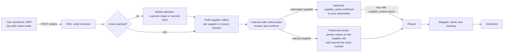
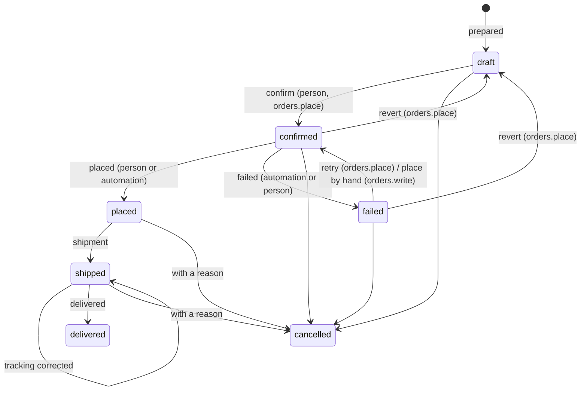

# Orders

Your storefront, ERP or scripts send customer orders to REA. REA matches each line to a product
you imported, and prepares **draft purchase orders to your suppliers** (supplier orders), one per
supplier. A supplier order is handed off for placement **only after a signed-in person confirms it**
in the dashboard. A person then places it on the supplier's site, or, for suppliers you set to
automated placement, your own automation places it and reports back. REA records the supplier's
order number, costs and tracking, and tells your systems through the API and webhooks.

## What REA never does

- REA never buys anything, never contacts a marketplace or supplier, never signs in to supplier
  sites and never reads credentials, cookies or tokens from them.
- **Nothing is confirmed automatically.** There is no setting, rule, flag, integration key scope or
  token type that confirms a supplier order. Confirmation needs a person with `orders.place` in a
  dashboard session (CSRF-protected); integration keys, personal API tokens and extension tokens
  are refused with `403`.
- Drafts never leave REA: integration keys cannot read them, and `supplier_order.confirmed` is only
  created by the confirmation itself (and by a retry a person requests).
- Customer names, e-mail addresses, phone numbers and addresses are never written to the server
  log or the audit log, are never sent to AI providers (orders are not records AI tools can use),
  and can be erased.

## The flow



## Statuses

A **customer order's** status is derived from its lines and supplier orders after every change:

| Status | When |
| --- | --- |
| `received` | Stored, with nothing prepared yet (a passing state while the order is taken in) |
| `needs_attention` | A line is in no supplier order: unmatched, or its supplier order was cancelled |
| `awaiting_confirmation` | Every supplier order is a draft |
| `in_progress` | Confirmations or placements are under way (or some failed) |
| `placed` | Every supplier order is placed |
| `partially_shipped` | Some supplier orders shipped |
| `shipped` | Every supplier order shipped (or was delivered) |
| `delivered` | Every supplier order was delivered |
| `cancelled` | The order, or every one of its lines, was cancelled |

`needs_attention: true` is also set while a supplier order's placement failed. Cancelled supplier
orders are ignored.

A **supplier order** moves through these states:



`placed` is only reachable from `confirmed`: reporting a placement for a draft answers `409
not_confirmed` for every caller.

## Sending orders

Create an integration key with the `orders.write` scope under **Settings → Integrations**, then:

```bash
export REA_API='https://rea.example.com/api/v1'
export REA_KEY='reai_…'   # orders.write
curl -fsS -H "Authorization: Bearer $REA_KEY" -H 'Content-Type: application/json' "$REA_API/orders" -d '{
  "external_id": "1001",
  "ordered_at": "2026-10-17T09:30:00Z",
  "currency": "EUR",
  "subtotal": "39.80", "shipping_amount": "4.90", "tax_amount": "0", "total": "44.70",
  "customer": {"name": "Ada Lovelace", "email": "ada@example.org", "phone": "+44 20 7946 0000"},
  "shipping_address": {"name": "Ada Lovelace", "company": "", "line1": "12 Example Street", "line2": "",
                       "city": "London", "region": "", "postal_code": "N1 7AA", "country": "GB", "phone": "+44 20 7946 0000"},
  "customer_note": "Leave at the door",
  "lines": [
    {"external_line_id": "1001-1", "sku": "MUG-RED-L", "title": "Red mug, large", "quantity": 2, "unit_price": "19.90"},
    {"variant_id": "6a0e6d8e-6f43-4b5e-9d11-1f8c7c1a0001", "quantity": 1, "unit_price": "4.90"}
  ]
}'
```

| Field | Rules |
| --- | --- |
| `external_id` | Your order ID, 1–200 characters; required for integration keys, optional for orders entered by hand |
| `currency` | ISO 4217 code of what the customer paid |
| `subtotal`, `shipping_amount`, `tax_amount`, `total` | Optional decimal strings ≥ 0, at most 4 decimals (informational; REA charges no one) |
| `customer` | `name` (≤ 200), `email` (valid address), `phone` (≤ 60); all optional |
| `shipping_address` | `name`, `company`, `line1`, `line2`, `city`, `region`, `postal_code`, `country` (ISO 3166-1 alpha-2, for example `DE`), `phone`; all optional at intake, but a supplier order cannot be confirmed without recipient, street and country |
| `lines` | 1–200 lines: `quantity` 1–10000, optional `unit_price`, `sku` (≤ 200), `title` (≤ 500), `external_line_id` (unique per order), and optionally catalog `product_id` / `variant_id`. A line needs a SKU, a title or an ID |

Unknown fields are rejected (`400`), invalid values answer `422 validation_failed` with field
errors such as `lines.0.quantity`. The response is the order (`OrderDetail`) with `201 Created`.

**Idempotency.** Orders are unique per integration key and `external_id` (orders entered by hand:
per `external_id` among manual orders). Sending the same order again returns the existing order
with `200 OK` and creates nothing; sending the same `external_id` with different contents is
refused with `409 order_conflict` (orders are not changed by resubmitting). Another key may use
the same `external_id`; REA then shows a `possible_duplicate` warning on its supplier orders. When
you rotate a key, look old orders up in the dashboard: `by-external-id` only searches the calling
key's orders.

**Line resolution.** A `variant_id` resolves to that variant (and must belong to `product_id` when
both are sent); a `product_id` to that product. Otherwise the SKU is matched case-insensitively
against variant SKUs first, then product SKUs, among all products in REA (drafts and archived
products too: they get a warning). A SKU matching several variants or products, or none, leaves the
line **unmatched**: the order needs attention until a person maps the line (**Map to a product**,
`PUT /orders/{id}/lines/{lineID}`) or cancels it.

**Preparation.** Matched lines take a snapshot of the product's supplier, source link (the source
URL, else the canonical URL), variant options and **expected unit cost**: the variant's stored cost
when it has one, else the product's cost (see [pricing.md](pricing.md)). Lines are grouped into one
draft per supplier (the product's primary supplier); products without a supplier record are grouped
by source domain. A draft copies the order's shipping address and takes the supplier's placement
method. **Prepare again** (`POST /orders/{id}/prepare`) resolves unmatched lines once more (for
example after importing the missing product) and rebuilds the drafts with the current product data.
Re-mapping a line, changing its quantity or cancelling it also rebuilds the drafts. **Only drafts are
ever rebuilt**: confirmed, placed and later supplier orders, and their lines, never change.

## Review and confirmation

`GET /supplier-orders/{id}` returns the draft with its items, ship-to, note, warnings and
`content_hash`. Warnings:

| Code | Meaning |
| --- | --- |
| `unmatched_lines` | Lines of the customer order are in no supplier order |
| `possible_duplicate` | Another open order has the same external order ID |
| `incomplete_address` | Recipient, street, city, postal code or country missing |
| `product_missing` | The matched product was deleted |
| `not_published` | The product is not active and approved |
| `availability` | The product or variant is out of stock, discontinued or of unknown availability |
| `variant_not_selected` | The product has variants but the line names none |
| `no_source_url` | There is no link to order the item from |
| `missing_cost` | No cost is stored, so the expected cost is unknown |
| `mixed_currencies` | Costs are in several currencies (no total) |
| `negative_margin` | The sale price is below the expected cost (compared in one currency, or converted with your exchange rates) |

The **content hash** is a SHA-256 over exactly what will be confirmed: the supplier, the placement
method, every item (line, product, variant, SKU, title, options, quantity, source link, expected
unit cost and currency), the expected total, the ship-to, the note to the supplier and the warnings
shown. Confirm with the hash you reviewed:

```bash
# Dashboard session only (cookie + X-CSRF-Token); shown here for reference.
POST /api/v1/supplier-orders/{id}/confirm
{"content_hash": "3f1c…", "acknowledge_warnings": true}
```

| Answer | When |
| --- | --- |
| `200` | Confirmed: `confirmed_by`, `confirmed_at` and the hash are recorded, with an audit event and a timeline entry |
| `403` | Not a dashboard session, no `orders.place`, an integration key, a personal or extension token, or a missing CSRF token |
| `409 content_changed` | Anything changed since the person looked (items, ship-to, note, supplier, placement method, product data behind a warning) |
| `409 not_draft` | It is not a draft (for example confirmed twice) |
| `422 no_items` / `ship_to_missing` | Nothing to order, or no recipient, street or country |
| `422 warnings_not_acknowledged` | There are warnings and `acknowledge_warnings` was not true |

The dashboard's **Review and confirm** dialog lists the items, quantities, options, source links,
expected cost total, ship-to and placement method, requires ticking *I reviewed the warnings* when
there are any, and sends the hash it displayed. Drafts can be edited before confirming (ship-to
and note to the supplier, `PUT /supplier-orders/{id}`); this changes the hash.

## Placement

Each supplier has an **order placement** method (supplier form; changing it needs `orders.place`).
Drafts follow their supplier's method until they are confirmed; the confirmed method is frozen.

**Manual (default).** The supplier order waits in **Supplier orders → To place**. Its placement
sheet shows each item with its source link, options, quantity and expected cost, and the ship-to
with copy buttons. The person orders on the supplier's site and records it:

```bash
POST /api/v1/supplier-orders/{id}/placed
{"supplier_order_number": "A-778812", "actual_cost": "11.20", "currency": "EUR", "note": "Paid by card"}
```

**Automation.** On confirmation REA creates a `supplier_order.confirmed` webhook delivery (see
below) for every enabled endpoint subscribed to it: the full purchase order including the ship-to.
Your automation places it through whatever official channel you use and reports back with an
integration key that has `supplier_orders.report`:

```bash
export REA_BOT_KEY='reai_…'   # supplier_orders.report
curl -fsS -H "Authorization: Bearer $REA_BOT_KEY" "$REA_API/supplier-orders?queue=to_place"
curl -fsS -H "Authorization: Bearer $REA_BOT_KEY" "$REA_API/supplier-orders/$ID"
curl -fsS -H "Authorization: Bearer $REA_BOT_KEY" -H 'Content-Type: application/json' \
  "$REA_API/supplier-orders/$ID/placed" -d '{"supplier_order_number":"A-778812","actual_cost":"11.20","currency":"EUR"}'
curl -fsS -H "Authorization: Bearer $REA_BOT_KEY" -H 'Content-Type: application/json' \
  "$REA_API/supplier-orders/$ID/failed" -d '{"reason":"The listing is no longer available"}'
```

A failed supplier order needs attention. A person can **retry** it (`orders.place`; the same
supplier order is handed off again as a new `supplier_order.confirmed` event with `attempt`
increased), **place it by hand** (`POST /supplier-orders/{id}/switch-to-manual`, `orders.write`),
revert it to draft or cancel it. Deduplicate on the supplier order `id` and `attempt`, and on the
event ID for redeliveries.

## Shipment, delivery and cancellation

- `POST /supplier-orders/{id}/shipment` `{"carrier", "tracking_number", "tracking_url"}` (HTTPS
  links only) moves a placed order to `shipped`; sending it again corrects the tracking.
  `POST /supplier-orders/{id}/delivered` marks a shipped order delivered. Both are allowed for
  people with `orders.write` and for `supplier_orders.report` keys (automated suppliers).
- **Cancel** (`POST /supplier-orders/{id}/cancel`, `orders.write`): drafts, confirmed and failed
  supplier orders can be cancelled; a placed or shipped one can be **marked** cancelled with a
  reason (for example "the supplier cancelled"). REA does not contact the supplier. The lines go
  back to the order, which needs attention until they are prepared again, mapped elsewhere or
  cancelled. Cancelling a supplier order that had been confirmed sends `supplier_order.cancelled`.
- **Revert to draft** (`POST /supplier-orders/{id}/revert`, `orders.place`, dashboard session)
  withdraws a confirmation that has not been placed: the hash and confirmer are cleared and a new
  confirmation is needed. Automated suppliers get `supplier_order.cancelled` with the reason
  "Confirmation withdrawn" so your automation stops.
- **Cancel a customer order** (`POST /orders/{id}/cancel`): its integration key or a person with
  `orders.write`, while none of its supplier orders is placed (`409 supplier_order_placed`
  otherwise). Its open supplier orders are cancelled with it.

## API

| Endpoint | People | Integration keys |
| --- | --- | --- |
| `GET /orders` (`status`, `needs_attention`, `channel`, `integration_key_id`, `q` on number or external ID, `from`, `to` (RFC 3339, `to` exclusive), `limit`, `offset`) | `orders.read` | `orders.write`: its own orders |
| `POST /orders` | `orders.write` (manual channel) | `orders.write` |
| `GET /orders/{id}`, `GET /orders/by-external-id/{external_id}` | `orders.read` (by external ID: manual orders) | `orders.write`: its own orders, without sourcing data or timeline |
| `POST /orders/{id}/cancel` | `orders.write` | `orders.write`: its own orders |
| `POST /orders/{id}/prepare`, `PUT /orders/{id}/lines/{lineID}`, `POST /orders/{id}/lines/{lineID}/cancel` | `orders.write` | — |
| `POST /orders/{id}/erase-customer` | `orders.write`, dashboard session | — |
| `GET /supplier-orders` (`queue` = `to_confirm`, `to_place`, `awaiting_tracking`, `failed`; `status`, `placement_method`, `supplier_id`, `order_id`, `q`) | `orders.read` | `supplier_orders.report`: confirmed and later supplier orders of automated suppliers |
| `GET /supplier-orders/queues` | `orders.read` | — |
| `GET /supplier-orders/{id}` | `orders.read` | `supplier_orders.report`: as above (drafts are `404`) |
| `PUT /supplier-orders/{id}` (draft ship-to and note) | `orders.write` | — |
| `POST /supplier-orders/{id}/confirm`, `/revert`, `/retry` | `orders.place`, dashboard session | never |
| `POST /supplier-orders/{id}/switch-to-manual`, `/cancel` | `orders.write` | — |
| `POST /supplier-orders/{id}/placed`, `/failed`, `/shipment`, `/delivered` | `orders.write` | `supplier_orders.report`: automated suppliers |

Lists use the usual `{"items", "total", "limit", "offset"}` envelope. The OpenAPI document (tag
`Orders`) has every request and response schema.

## Permissions and scopes

| Permission | Allows | Default roles |
| --- | --- | --- |
| `orders.read` | See orders, customer data and supplier orders | Administrator, Analyst, Member |
| `orders.write` | Enter orders, map lines, edit drafts, record placements and shipments, cancel, erase customer data | Administrator, Analyst, Member |
| `orders.place` | Confirm supplier orders (spends money), revert and retry confirmations, change a supplier's placement method | Administrator |

Viewers get none of them because orders carry personal data; administrators can grant them under
**Settings → Roles**. Personal API tokens can carry `orders.read` and `orders.write` for scripts,
but no token can confirm. Browser extension tokens cannot reach orders at all.

| Integration scope | Allows |
| --- | --- |
| `orders.write` | Submit and cancel customer orders, and read the orders submitted with the same key (with status and tracking; not supplier names, costs or the timeline) |
| `supplier_orders.report` | Read confirmed and later supplier orders of suppliers with automated placement (items, source links, ship-to, expected costs) and report placements, failures, shipments and deliveries |

An `orders.write` key cannot read the catalog unless it also has `catalog.read`, and cannot report
placements. No scope can confirm.

## Webhooks

Order events use the same endpoints, signing, retries and SSRF protection as catalog events
([catalog-api.md](catalog-api.md#webhooks)). They are created in the transaction that makes the
change, only for enabled endpoints subscribed to the event. The dashboard never preselects them.

| Event | When |
| --- | --- |
| `order.received` | A customer order was received |
| `order.status_changed` | Its derived status changed (`previous_status` holds the old one) |
| `supplier_order.confirmed` | A person confirmed a supplier order of an automated supplier, or retried it |
| `supplier_order.placed` | A placement was recorded or reported |
| `supplier_order.failed` | A placement failure was reported |
| `supplier_order.shipped` | Tracking was recorded or corrected |
| `supplier_order.cancelled` | A confirmed, failed, placed or shipped supplier order was cancelled, or its confirmation withdrawn (`status: "draft"`) |

**Payloads contain personal data** (the customer's name, e-mail, phone and shipping address, and
the ship-to). Subscribe only systems you trust with it. Cost fields (`supplier_order.costs` and
`items[].cost`) are present only for endpoints with *include costs*.

```json
{
  "id": "0b8b4c2e-…", "type": "supplier_order.confirmed", "occurred_at": "2026-10-17T10:02:11Z", "previous_status": "draft",
  "order": {
    "id": "…", "number": "SO-000042", "channel": "api", "external_id": "1001", "status": "in_progress", "needs_attention": false,
    "ordered_at": "2026-10-17T09:30:00Z", "currency": "EUR", "subtotal": "39.8", "shipping_amount": "4.9", "tax_amount": "0", "total": "44.7",
    "customer": {"name": "Ada Lovelace", "email": "ada@example.org", "phone": "+44 20 7946 0000"},
    "shipping_address": {"name": "Ada Lovelace", "company": "", "line1": "12 Example Street", "line2": "", "city": "London", "region": "",
                         "postal_code": "N1 7AA", "country": "GB", "phone": "+44 20 7946 0000"},
    "customer_note": "Leave at the door", "customer_erased": false, "cancelled_at": null,
    "lines": [{"id": "…", "position": 0, "external_line_id": "1001-1", "sku": "MUG-RED-L", "title": "Red mug, large", "quantity": 2,
               "unit_price": "19.9", "product_id": "…", "variant_id": "…", "resolution": "matched_variant", "supplier_order_id": "…", "cancelled": false}]
  },
  "supplier_order": {
    "id": "…", "number": "PO-000051", "status": "confirmed", "placement_method": "automation", "supplier_id": "…",
    "supplier_name": "Ningbo Mugs", "source_domain": "mugs.example.com", "attempt": 1,
    "items": [{"line_id": "…", "product_id": "…", "variant_id": "…", "sku": "MUG-RED-L", "title": "Enamel mug", "variant_title": "Red / L",
               "options": {"Color": "Red", "Size": "L"}, "quantity": 2, "source_url": "https://mugs.example.com/p/enamel",
               "cost": {"expected_unit_cost": "3.1", "cost_currency": "EUR"}}],
    "ship_to": {"name": "Ada Lovelace", "company": "", "line1": "12 Example Street", "line2": "", "city": "London", "region": "",
                "postal_code": "N1 7AA", "country": "GB", "phone": "+44 20 7946 0000"},
    "note_to_supplier": "", "confirmed_at": "2026-10-17T10:02:11Z", "supplier_order_number": "", "placed_at": null,
    "failure_reason": "", "failed_at": null, "carrier": "", "tracking_number": "", "tracking_url": null, "shipped_at": null,
    "delivered_at": null, "cancelled_at": null, "cancel_reason": "",
    "costs": {"expected_cost_total": "6.2", "cost_currency": "EUR", "actual_cost": null, "actual_currency": null}
  }
}
```

`supplier_order` is `null` for `order.*` events. The OpenAPI document describes the body as
`OrderWebhookEvent` under `x-webhooks`.

## Personal data and erasure

- Customer data is stored in the order and copied into each supplier order's ship-to. It is
  visible only with `orders.read` (and to the integration key that submitted the order), is never
  included in audit events (they record who did what, numbers and status changes), the order
  timeline or the server log (requests are logged by route pattern, without query strings or
  bodies), and is not reachable by AI tools.
- Full data exports include the order tables only for people with `orders.read`.
- **Erase customer data** (`POST /orders/{id}/erase-customer`, `orders.write`, dashboard session,
  confirmed in the UI) replaces the customer's name, e-mail, phone, both addresses (the country is
  kept) and the free-text notes (customer note, note to the supplier, placement note, failure and
  cancellation reasons) with `[erased]`, in the order, its supplier orders and every stored webhook
  payload of the order, including deliveries still pending. It is allowed once no supplier order is
  a draft, confirmed or failed (cancel the order first if it will not be fulfilled). Tracking numbers,
  supplier order numbers, costs, the lines as sold and the external order ID are kept, and so is the
  SHA-256 fingerprint of the original submission, so a repeated submission is still recognized
  (it then returns the erased order). The audit event records the order number only.

## Audit and timeline

Every change writes an audit event (`order.receive`, `order.line_update`, `order.line_cancel`,
`order.prepare`, `order.cancel`, `order.erase_customer`, `supplier_order.update`, `.confirm`
(with the hash, the warnings acknowledged and the expected total), `.revert`, `.retry`,
`.switch_to_manual`, `.placed`, `.failed`, `.shipment`, `.delivered`, `.cancel`) with the actor (a
person or an integration key) and from/to statuses, and an entry in the order's timeline on the
order page.
